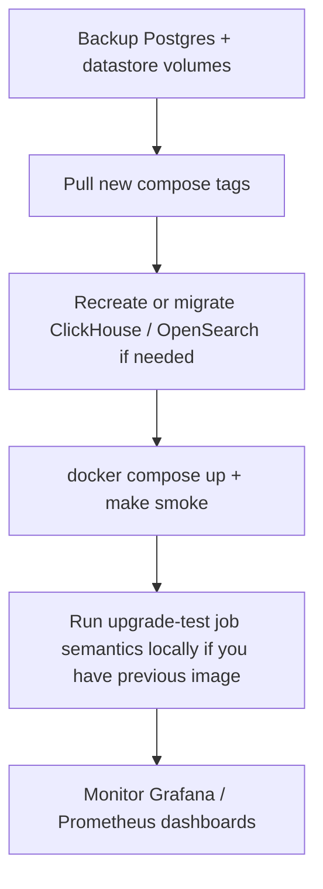

# Dependency and infrastructure modernization (2026-11)

This document records the **first modernization stage** on branch
`cursor/dependency-modernization-110d`: datastore and observability image pins,
Go runtime base images, cross-surface consistency, inventory tooling, and tests.
Language lockfiles (Poetry / pnpm) remain on the existing Dependabot cadence unless
noted under [Deferred work](#deferred-work).

Regenerate the machine-readable inventory:

```bash
python3 scripts/generate_dependency_inventory.py
python3 scripts/generate_dependency_inventory.py --check
```

Output: [`dependency-inventory.json`](dependency-inventory.json).

---

## Repository relationship

| Remote | URL | Role |
|--------|-----|------|
| `origin` | `knowlet/AiSOC` | Fork; PR target for this work |
| `upstream` | `beenuar/AiSOC` | Upstream; merged into this branch once (fast-forward) for baseline |

No changes to Copilot / auth-session / url-navigation branches.

---

## Before → after (infrastructure images)

Sources of truth: `docker-compose.yml` (dev stack), `infra/helm/aisoc/values.yaml`
(Qdrant), selected `.github/workflows/*-live.yml` (CI sidecars). Tags verified on
Docker Hub before pin.

| Component | Before | After | Migration notes |
|-----------|--------|-------|-----------------|
| ClickHouse | `23.8` | `24.8` | **Major datastore.** Existing `clickhouse_data` volumes from 23.x require backup + restore or `make clean` / volume recreate. SQL init under `services/api/clickhouse/` unchanged; rehearse on a copy. |
| Confluent Kafka / ZK | `7.5.0` | `7.7.1` | Broker log format compatible within 7.x; keep `kafka_data` + `zookeeper_*` volumes paired. |
| Qdrant | `v1.7.0` | `v1.12.5` | Collection APIs stable; snapshot `qdrant_data` before upgrade. |
| Neo4j | `5.15-community` | `5.26.0-community` | Minor within 5.x; backup `neo4j_data` / `neo4j_logs`. |
| OpenSearch | `2.11.0` | `2.19.0` | **Index store on disk** may require reindex after major jump; backup `opensearch_data`. |
| Kafka UI | `latest` (floating) | `v0.7.2` | Reproducibility only (`full` profile). |
| Prometheus | `v2.48.0` | `v2.55.1` | Stay on Prometheus 2.x line; scrape config unchanged. |
| Alertmanager | `v0.27.0` | `v0.28.1` | Config compatible. |
| OTel Collector | `0.109.0` | `0.120.0` | Verify custom receivers in `infra/docker/otel-collector.yaml` if you extended it. |
| Tempo | `2.6.0` | `2.7.1` | |
| Grafana | `10.2.0` | `11.5.2` | **Major.** Re-check provisioned dashboards under `infra/docker/grafana/`. |
| Ingest / enrichment runtime | `alpine:3.19` | `alpine:3.21` | musl/glibc unaffected (static Go binaries). |

Unchanged in this stage (intentional):

| Component | Pin | Reason |
|-----------|-----|--------|
| PostgreSQL | `16-alpine` | Current LTS line; app migrations unchanged. |
| Redis | `7-alpine` | Supported 7.x. |
| Python service images | `python:3.11-slim` | Toolchain gate: CI and all 13 service images agree on 3.11; 3.12 is a separate migration. |
| Node / web | `node:22-alpine`, pnpm `8.15.1` | ESLint 9 / TS 6 holds per `.github/dependabot.yml`. |
| Go toolchain | `1.26` | `go.mod` across ingest, enrichment, demo-producer, SDKs. |
| Ollama / LiteLLM | `0.6.7`, `v1.102.1` | Model pull + gateway contract; upgrade in a dedicated LLM runtime PR. |
| Helm Kafka (KRaft) | `apache/kafka:3.9.1` | Production chart path; independent of Confluent compose dev stack. |

---

## Application dependencies (Poetry / pnpm / Go)

| Surface | Count (approx.) | Policy |
|---------|-----------------|--------|
| Poetry services | 14 under `services/` + packages | Weekly Dependabot; CI installs **locked** closure via `scripts/service_requirements.py --locked` |
| pnpm workspace | Root + `apps/web`, `apps/docs`, packages | Root `pnpm-lock.yaml`; overrides in `package.json` for security floors |
| Go modules | 6 `go.mod` files | `go.sum` pinned; CI `go 1.26` |

This PR does **not** mass-refresh Poetry or pnpm locks to avoid hiding compatibility
failures in a single diff. Run `python scripts/security_audit.py` locally for audit
baseline comparison.

---

## Phased rollout



### Preflight

1. `pg_dump` operational Postgres (see [`MIGRATION.md`](MIGRATION.md) step 1).
2. Snapshot or export: `clickhouse_data`, `opensearch_data`, `neo4j_data`, `qdrant_data`, `kafka_data`, `zookeeper_*`.
3. Record current pins: `python3 scripts/generate_dependency_inventory.py`.

### Acceptance criteria

- `make doctor` green for CORE profile.
- `make smoke` passes (or document environment blockers).
- `pytest` gates listed in PR body pass on CI.
- No new high/critical findings from `security-audit` workflow beyond documented ignores.

### Rollback

1. Revert Git to pre-modernization commit (image tags + locks).
2. `docker compose pull` with **old** tags from rollback commit.
3. Restore volumes from snapshots if forward migration mutated on-disk formats.
4. **Irreversible without restore:** ClickHouse 24.x data paths, OpenSearch 2.19 index store, Kafka retained messages (usually compatible within 7.x).

Pin rollback explicitly in `.env` or compose override:

```yaml
services:
  clickhouse:
    image: clickhouse/clickhouse-server:23.8
```

---

## Compatibility testing matrix (this stage)

| Area | Executed locally in agent run | Notes |
|------|------------------------------|-------|
| `ruff check` + `ruff format --check` | Yes | Pin `ruff>=0.16.8,<0.17` |
| `check_toolchain_pins.py` | Yes | |
| `generate_dependency_inventory.py --self-test` | Yes | |
| `check_mypy_baseline.py` | See PR CI | |
| Per-service Poetry unit tests | Subset / CI | Full matrix on push |
| pnpm lint / tsc / vitest | CI | |
| `docker compose` build + smoke | Blocked if Docker daemon / RAM insufficient | Logged in PR |
| Playwright e2e | CI (`e2e.yml`) | |
| Disposable ClickHouse 23→24 migration | **Not executed** in agent VM | Operator must rehearse |
| Production Helm upgrade | **Not executed** | Chart values: Qdrant tag only |

---

## Deferred work

| Item | Blocker / plan |
|------|----------------|
| Python **3.12** images + `ruff` `target-version` | All services + mypy baselines; one coordinated PR |
| TypeScript **7** / ESLint **10** | `dependabot.yml` ignores; `eslint-plugin-react` compatibility |
| pnpm **9+** | `packageManager` pin + store migration |
| Ollama / LiteLLM bump | Triage model compatibility + airgap overlays |
| Mass `poetry update` | Split per service or Dependabot groups |

---

## References

- [Migration guide (v3 → v4)](MIGRATION.md)
- [Architecture](../../docs/architecture/README.md)
- ClickHouse release notes: https://clickhouse.com/docs/en/whats-new/changelog
- Confluent Platform 7.7 release notes: https://docs.confluent.io/platform/current/release-notes/index.html
