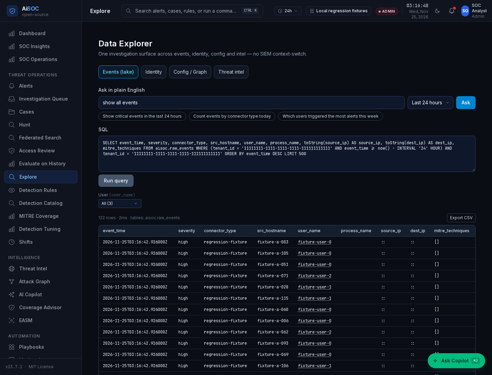

# Data Explorer replay verification

Tested source commit: c0288410b31f57e5987710ef9f53810596646c6d
Tested source tree: 2d63c3b0833a945062ffc69bb70ca275089614f4
Baseline: b13b72baa2d7c3fdd819b31b6fafbcba80d38323

## Results

- Frontend: 134 test files, 1,363 tests passed. Coverage: statements 60.68%, branches 56.72%, functions 53.06%, lines 62.71%.
- Focused backend compiler, renderer, driver, disclosure, endpoint and SQL policy suites: 140 passed.
- Real application route suite with PostgreSQL 17.12 and ClickHouse 24.3.18.7: 14 passed.
- Browser verification: 5 groups passed using the production web build, real HTTP API, real databases and Chromium headless shell 156.0.8078.108.
- TypeScript and production build passed.
- Ruff check and format passed; mypy baseline passed without a baseline change.
- ESLint: 0 errors, 97 warnings, identical warning count on baseline.
- OpenAPI snapshot check, attribution and competitor-name gates passed.
- Full API suite: 5,666 passed, 274 skipped, 1 expected failure, 18 failed. All 18 failing IDs reproduced on the unchanged baseline.

## Negative controls

- Original component with new regressions: 11 failed, 15 passed; fixed component: 26 passed; reverting the component reproduced the same 11 failures.
- Original API routes: both Ask-to-Run tests failed with the reported SQLGlot Mod parse error and HTTP 400.
- Reverting only absent-parameter handling in the driver: 3 filter cases failed, 2 passed; restoring the fix passed all 7 replay cases.

## Browser steps

1. Ask for all events and receive 122 records from the authenticated fixture tenant.
2. Run the generated SQL twice; both responses contain the same 122 fixture records, with row_cap=500.
3. Edit the SQL to use ILIKE percent wildcards and execute it successfully.
4. Submit malformed SQL, edit the text, and Retry; Retry submits the original failed SQL and prior facets are cleared.
5. Temporarily rename the disposable event table, Ask and observe the real backend failure. Restore the table, edit the question and time selector, then Retry; the original NL request succeeds with its original time window and row cap.

All displayed records are synthetic local regression fixtures. The tenant is labelled "Local regression fixtures"; these are not production telemetry. API startup workers were disabled for the HTTP browser run with uvicorn --lifespan off; authentication, routing, compiler, database dependencies, SQL policy and database execution remained real.



## Environment limitations

The original executor environment exposes SOCKS proxy settings without HTTPX's optional socksio dependency. Removing only ALL_PROXY and all_proxy resolves 11 of the 18 full-suite failures. The remaining 7 failures need DNS for public-destination checks before mocked transport calls; DNS is unavailable in this executor. The diagnostic selection (18 failing cases plus one passing case) gives identical results on baseline and patch: 18 failed/1 passed originally and 7 failed/12 passed after that environment correction. No guards, tests, dependencies or baseline ceilings were weakened.

The Playwright client is pinned by the repository lockfile (1.65.1); the available distribution browser was Chromium 156.0.8078.108, not Playwright's bundled browser. PostgreSQL here was 17.12; the live workflow defaults to PostgreSQL 16. Full CORE make up/make smoke and upstream pull-request CI were not run.

## Reproduction commands

From the repository root:

```bash
pnpm install --frozen-lockfile --filter @aisoc/web...
pnpm --filter @aisoc/web test:cov -- --maxWorkers=2
pnpm --filter @aisoc/web lint
pnpm --filter @aisoc/web type-check
pnpm --filter @aisoc/web build
ruff check services/ scripts/ tests/ tools/
ruff format --check .
python scripts/check_mypy_baseline.py
python scripts/export_openapi.py --check
python scripts/check_attribution.py --self-test
python scripts/check_attribution.py --all
python scripts/check_competitor_names.py --self-test
python scripts/check_competitor_names.py --root .
```

From services/api, using the API lockfile environment:

```bash
python -m pytest tests/ -q --tb=short
python -m pytest -q tests/test_lake_hunt.py tests/test_lake_replay.py tests/test_nl_query_disclosure.py tests/test_lake_driver_parameters.py tests/test_lake_endpoint.py tests/test_lake_sql.py tests/test_lake_sql_fail_closed.py tests/test_lake_hunts_can_reach_the_corpus_fields.py
python -m pytest ../../tests/isolation/test_lake_route_live.py -v --tb=short
```

The live command requires the isolated PostgreSQL/ClickHouse connection variables documented in the test module and the repository's Event lake (live) workflow. It loads the shipped ClickHouse DDL; all 175 PostgreSQL migrations were applied.
