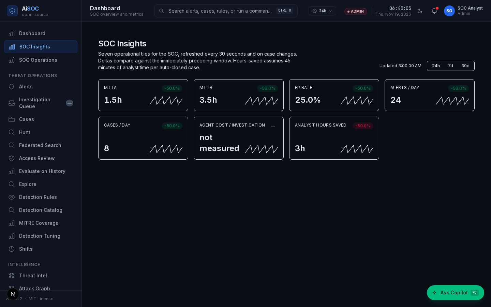
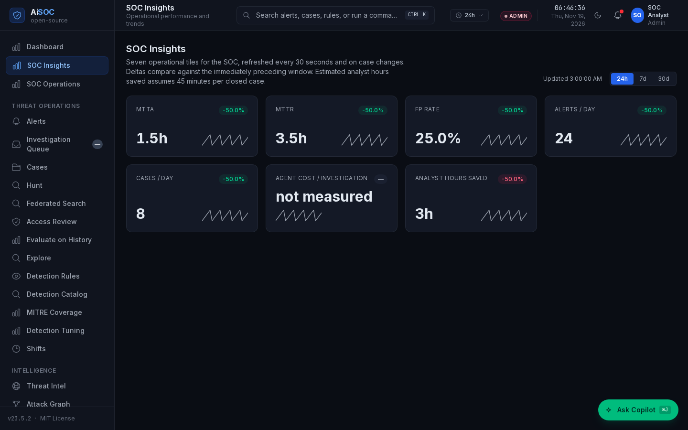
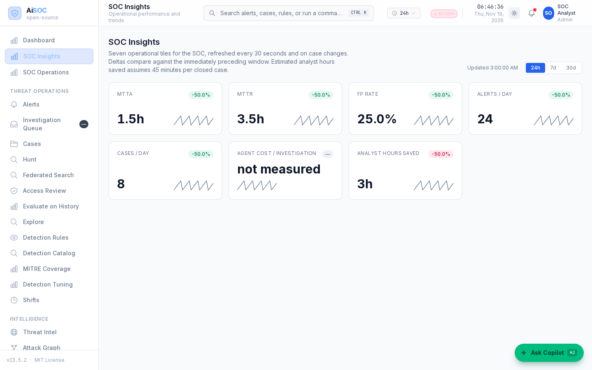

## Summary

`/dashboards/soc-insights` used undefined theme tokens, duplicated the shell padding, and cleared successful data during realtime refreshes. Its API also performed 17–19 sequential data SELECTs and could repeatedly scan investigation runs under a slow generic query plan with row security. This fixes the page styling and refresh behavior, reduces the API to three bounded aggregate reads, and materializes the permitted runs before the cost join while preserving the response schema and measurement denominators.

## Type of change

- [x] Bug fix (non-breaking change that fixes an issue)
- [ ] New feature (non-breaking change that adds functionality)
- [ ] Breaking change (fix or feature that would cause existing functionality to not work as expected)
- [ ] Documentation update
- [ ] Refactor / tech debt
- [ ] CI / infra change

## Related issues

Addresses the reported inconsistent styling and slow loading on `/dashboards/soc-insights`. No separate issue was filed.

## Changes

- Use the existing `surface`, `fg`, and `brand` tokens, dashboard spacing, and theme-aware cards. Correct the top-bar route labels and match route segment boundaries.
- Retain the last validated snapshot during background refresh and recoverable errors, with an explicit refresh/retry state. Deduplicate remounts, coalesce realtime bursts, and queue at most one follow-up request during an in-flight read.
- Scope SWR by the transport's tenant and selected window; reject mismatched response scopes before caching. Changing scope cannot display the previous scope's data or pending response.
- Aggregate current/previous metrics and 24 sparkline buckets in PostgreSQL. Each dataset returns at most 25 rows to the API, including the previous-period group. Keep duration numerators as `Decimal` until final averaging so bucket aggregation preserves rounding.
- Materialize tenant/time-filtered investigation runs before joining cost records. This prevents repeated RLS-filtered scans under generic plans. Preserve historical cost tenant aliases, measured-cost inputs, distinct-run denominators, and both tables' existing row-security policies.
- Use the existing savepoint helper for optional cost reads; a real missing-column error no longer aborts the outer transaction. Use the same closed-case predicate in both comparison periods, and describe the hours-saved value as an estimate per closed case.
- Add live regressions to the existing migration workflow, including its change selection and locked API environment, and document the fix under `Unreleased`.

## Testing

- [x] Unit tests added / updated
- [x] Integration tests pass locally
- [x] Manually tested (rendered screenshots reviewed; browser interactions exercised by the journey tests below)

| Validation | Result |
| --- | --- |
| Full web Vitest suite | **1,296 passed**, 129 files |
| Focused SOC Insights / top-bar tests | **28 passed** |
| Web TypeScript check | Passed separately from the production build |
| Full web ESLint | 0 errors; 95 existing warnings. Changed SOC files have no warnings; the top-bar's two existing warnings also reproduce on upstream |
| Chromium journeys | **3 passed**: compiled theme/spacing/title, retained data through slow/failing refresh and retry, matching-window loading; includes a 390px tile-grid check |
| `test_insights_endpoint.py` | **15 passed** |
| `test_insights_live.py` | **8 passed** on PostgreSQL 16.2, the complete unchanged migration chain, and the `aisoc_app` runtime role |
| Existing `test_metric_denominators.py` | **11 passed** on real PostgreSQL |
| Pinned Ruff check / format; mypy baseline | Passed; final API findings exactly match the approved baseline |
| Tenant-query predicates, module reachability, attribution, competitor-name and released-changelog gates | Passed |
| Production web build | Passed with `MESH_HUB_URL=http://127.0.0.1:9 NEXT_TELEMETRY_DISABLED=1` |

The build condition above uses the existing marketing page's unavailable-statistics state. The default build tried to read the community mesh host and this environment's automatic approval review blocked that outbound request; the successful build performs no request to that host.

**Negative controls:** the original frontend fails 10 of the first 24 focused tests; four additional scope regressions fail without the scope correction. The original endpoint and the restored-original negative control each fail **6 of 8** live tests. Replacing only `MATERIALIZED` with `NOT MATERIALIZED` fails **1 of 8**, specifically the populated-cost generic-plan test under a 2-second database statement budget. The other seven continue to pass.

### Local HTTP measurement

The original `app.main` application, lifespan, JWT authentication and DB dependencies ran over real HTTP with PostgreSQL and Redis. The synthetic fixture has **20,000 alerts, 6,000 cases, 4,000 investigations and 8,000 cost records**, spread across the current and previous windows, plus a separate tenant's records.

Six consecutive 30-day requests completed: first **336.98 ms**; the five subsequent requests had **226.28 ms median** and **484.61 ms maximum**. The cost query took **68.55–91.88 ms**. Every request made **three data SELECTs** and received **75 aggregate rows from PostgreSQL**. Savepoint/release and authentication/session statements are additional to that SELECT count.

These are local loopback measurements over synthetic fixtures, not production latency estimates. [Recorded validation results](https://raw.githubusercontent.com/knowlet/AiSOC/7dc5b910d267a2ba968113e935f5e65b08f0b228/evidence/soc-insights/validation.json).

### Remaining verification limits

- The broad API suite was attempted but is **not claimed green**. All 15 observed failures reproduce identically on upstream `7fcfa5d7`: eight transport tests encounter the environment's SOCKS proxy without `socksio`, and seven depend on unavailable public DNS. The broad run was stopped during unrelated application-startup tests waiting for external services. The targeted unit and real-DB suites above completed.
- The full Compose `make up` / `make smoke` pipeline was not run because Docker is unavailable here. Unrelated Kafka, ClickHouse and Neo4j workers were unavailable during the local HTTP measurement.
- A session whose transport tenant disagrees with the API's authenticated tenant now shows an explicit scope error instead of relabeling the response. This also makes a missing/stale cached user profile visible; tenant authorization continues to be enforced by the API.

Manual test steps

1. Apply the unchanged API migrations and run `tests/test_insights_live.py` and `tests/test_metric_denominators.py` with `DATABASE_URL` using the runtime role and `MSSP_ISOLATION_REQUIRED=1`.
2. Run `PLAYWRIGHT_PROJECT=journey pnpm exec playwright test e2e/journeys/soc-insights.spec.ts --project=journey` from `apps/web`. Local execution used an explicit localhost bind and a Chromium headless-shell executable to fit the available environment.
3. Inspect the rendered dark/light page, including the unmeasured-cost tile. Compare its 24px shell inset and route title with the original page below.
4. Hold a realtime-triggered response open, then return 503: existing tiles remain visible, followed by a stale-update message. Retry restores the successful state.
5. Hold the 7-day response open after switching windows: the prior 24-hour data disappears until the matching response arrives.

## Screenshots (if UI changes)

All screenshots use the same explicitly **synthetic browser-test fixture**, including one unmeasured tile. They are not production metrics. The evidence branch is separate from this PR's source diff.

| Before | After — dark |
| --- | --- |
|  |  |

## Checklist

- [x] My code follows the style guidelines of this project (`ruff`, `eslint`, `gofmt`)
- [x] I have performed a self-review of my own code
- [x] I have added tests that prove my fix is effective or that my feature works
- [ ] New and existing unit tests pass locally — full web suite and scoped API suites pass; broad API limitations are disclosed above
- [x] I have updated documentation as needed (README, CHANGELOG, CONTRIBUTING)
- [x] My changes do not introduce new linter warnings
- [x] I have checked for sensitive data / credentials in my diff

## Eval harness (required for substrate / playbook / detection changes)

<strong>Before</strong>

Not applicable: this changes console rendering and the SOC Insights read endpoint.

<strong>After</strong>

Not applicable: no substrate, playbook, detection, prompt, RAG or eval inputs changed.

- [x] Not applicable — this PR does not touch substrate, playbooks, detections, or eval inputs
- [ ] No axis regressed
- [ ] An axis regressed; rationale and follow-up are described in the Summary above
